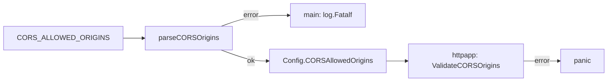

# CORS origin list

`CORS_ALLOWED_ORIGINS` is a comma-separated list of exact origins. `parseCORSOrigins` splits it and `validateOrigin` checks each entry (`config/config.go`). Unset or whitespace-only means no CORS.

## Rules

- Each entry is `scheme://host[:port]`, with scheme `http` or `https`.
- No path, query, fragment, userinfo, or trailing slash.
- No `*` anywhere, including host patterns.
- When the value is non-empty, leading, trailing, or repeated commas are errors.
- Port: 1-65535, canonical decimal with no leading zeros.
- Host: RFC 1123 DNS labels, or an IP literal. IPv6 must be bracketed.

```go
origins, err := parseCORSOrigins("https://app.example.com,http://localhost:3000")
```



## Rationale

- chi treats `*` as allow-all, so no wildcard may reach it.
- Skipping empty tokens, or trusting caller slices, would widen cross-origin access without warning.
- Validation runs twice: at env parse (startup error) and at `httpapp.New` (panic). Caller-supplied slices get the same rules.
- Rejected: skipping empty comma tokens as a convenience.
- Rejected: relying on chi defaults for empty or tainted lists.
- Rejected: turning a malformed non-empty list into "no CORS".

Tests: `config/config_test.go` (`TestParseCORSOrigins_*`, `TestValidateCORSOrigins`, `TestLoad_CORSFromEnv`) and `internal/httpapp/app_test.go` (`TestNew_RejectsWildcardOrigins`).

Related: [../http/cors.md](../http/cors.md).
