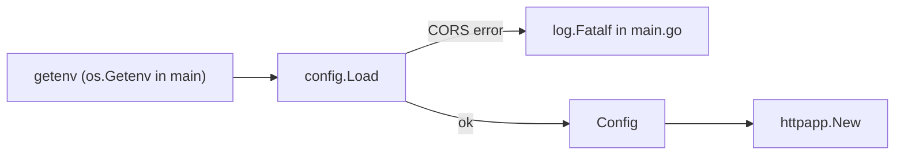

# Configuration

`config.Load(getenv func(string) string) (Config, error)` in `config/config.go` builds `config.Config` from the environment. `main.go` calls it with `os.Getenv`. Tests pass a map lookup.

| Env var | Field | If blank or unset |
|---------|-------|-------------------|
| `CORS_ALLOWED_ORIGINS` | `CORSAllowedOrigins` | unset or blank means no CORS; a malformed list returns an error |

- `Load` reads only `CORS_ALLOWED_ORIGINS`. It never logs, so no config value reaches the log.
- Only a malformed `CORS_ALLOWED_ORIGINS` fails startup. `main.go` calls `log.Fatalf` on that error.
- Redis and Postgres config is not supported. Their fields and env vars are added back when an integration needs them.

Related: [cors-origins.md](cors-origins.md).
