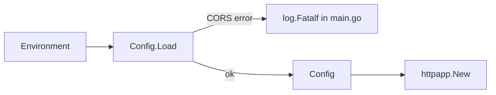

# Configuration

`config.Config` in `config/config.go` is loaded once from the environment by `main.go` (`cfg.Load()`).

| Env var | Field | If blank or unset |
|---------|-------|-------------------|
| `REDIS_HOST`, `REDIS_PASS` | `RedisHost`, `RedisPass` | logs a warning |
| `DB_USER`, `DB_PASS`, `DB_HOST`, `DB_PORT`, `DB_NAME` | `PostgresUser`, `PostgresPass`, `PostgresHost`, `PostgresPort`, `PostgresDB` | logs a warning |
| `CORS_ALLOWED_ORIGINS` | `CORSAllowedOrigins` | unset means no CORS; invalid returns an error |

- Only `CORS_ALLOWED_ORIGINS` can fail startup. `main.go` calls `log.Fatalf` on that error.
- The Redis and Postgres fields are loaded but not read by any code at HEAD. Only `CORSAllowedOrigins` reaches `main.go`.
- Known gap, not fixed: the blank-variable warnings pass the whole `*Config` to `log.Println`, so the passwords in the struct can reach `logs/site.log`.

Related: [cors-origins.md](cors-origins.md).
