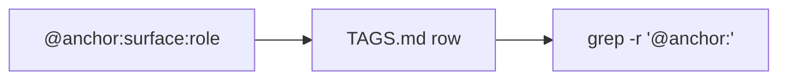

# Anchor tags

`// @anchor:<surface>:<role> [context]` marks a meaningful boundary in Go source so it can be found with `grep -r '@anchor:'`. The format and rules are in `TAGS.md`.

## Current anchors

- `main:lifecycle` in `main.go`
- `config:load` in `config/config.go`
- `httpapp:composition` in `internal/httpapp/app.go`

These match the rows in `TAGS.md`.

## Rationale

- Tags mark boundaries where decisions apply: lifecycle, config loading, and HTTP composition each have a `.mem/` file.
- Tags are not placed on helpers. Rationale lives in `.mem/`, so the tag context stays one clause.

Related: [../http/composition.md](../http/composition.md), [../config/summary.md](../config/summary.md).
