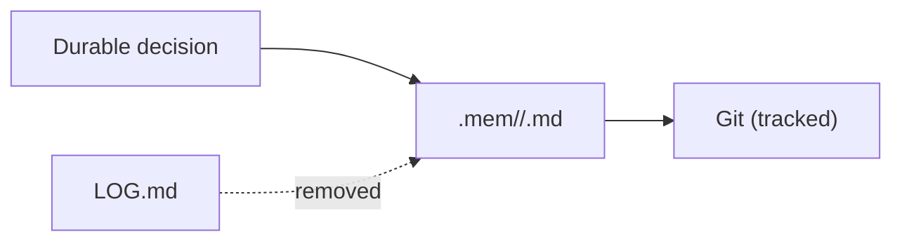

# Decision records

**Decision:** `.mem/` is the only record of durable project decisions and their rationale. It replaces the root-level `LOG.md`, which has been removed. Each decision is a current-state entry in the domain file it constrains, for example [../http/composition.md](../http/composition.md) and [../config/cors-origins.md](../config/cors-origins.md).

**Status:** Assumed decision: auto-approved by Jev (Low stakes, confidence 0.70); not reviewed by Jaron.

**Why:** A root log grows as history and drifts from the code. `.mem/` describes the current state, and `AGENTS.md` (Project Memory) names it as the canonical record.

**Rejected:** Keeping `LOG.md` alongside `.mem/`. Two decision records would disagree, and the log would hold superseded detail that Git already keeps.

- Write decisions as present-tense rules and rationale, not as dated entries.
- Put a decision in the file for the surface it constrains. Create a new topic file only when no existing file fits.
- Keep history in Git and release notes in `CHANGELOG.md`.

Related: [working-docs.md](working-docs.md), [records-review.md](records-review.md).
