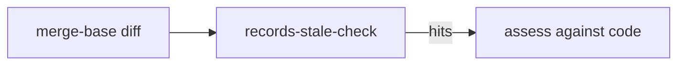

# Records review

A records review checks `.mem/`, `TAGS.md`, `README.md`, and `CHANGELOG.md` against the code. It runs before each commit (see `AGENTS.md`, Before Committing).

- Run `~/.agents/scripts/records-stale-check [base]`. It diffs `merge-base(HEAD, base)` against the working tree, so uncommitted changes count. It matches names lexically.
- Exit 0: no hits. Exit 1: hits to review. Exit 2: usage or Git error.
```sh
~/.agents/scripts/records-stale-check origin/master
```

- Hits can be historical or rejected references. Assess each one against current code.
- The tool scans `TAGS.md`, `.mem/`, and `changelog.d/`. It does not scan `README.md` or `CHANGELOG.md`, so those need a manual check.


