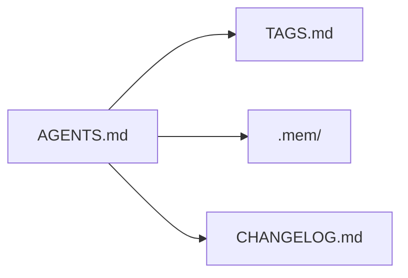

# Conventions

Repo rules for anchors, working docs, and records review. The rules themselves live in `AGENTS.md` and `TAGS.md`. These files record what each rule covers.

- [anchor-tags.md](anchor-tags.md) - `@anchor:` boundary tags and the `TAGS.md` index
- [working-docs.md](working-docs.md) - gitignored `docs/plans/` and `docs/notes/`
- [records-review.md](records-review.md) - what a records review covers and how stale references are found
- [decision-records.md](decision-records.md) - `.mem/` as the decision record, replacing `LOG.md`

