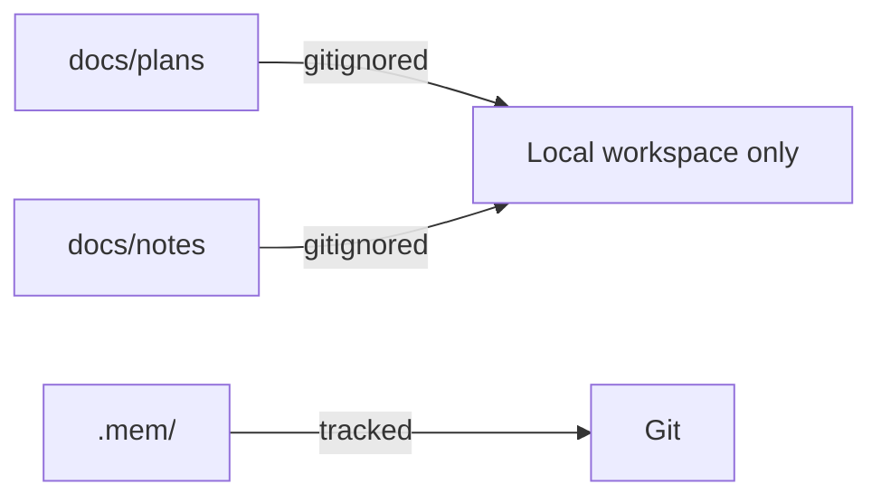

# Working docs

`docs/plans/` and `docs/notes/` hold local, ephemeral material. `.gitignore` excludes both under `# Agent Working Docs`, so they are never committed or shared through Git.

- `docs/plans/` holds non-code planning and implementation working documents.
- `docs/notes/` holds local context across agent sessions.
- Either may be removed when the local workspace is cleaned up.
- Canonical product and architecture documents go directly under `docs/`.
- Durable decisions go in `.mem/`, which is tracked.

```gitignore
# .gitignore
docs/plans/
docs/notes/
```


