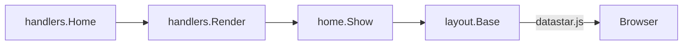

# Frontend

Server-rendered HTML from Templ, with Datastar for client behavior. `views/layout/base.templ` loads `datastar.js` as an ES module from the jsDelivr CDN.

## Rules

- Build behavior from `data-*` attributes and backend patches first. Write a `<script>` only where neither can (see `AGENTS.md`, Frontend: Datastar).
- Handlers render through `handlers.Render` (`handlers/render.go`), which takes a Templ component and an explicit status.

```go
// handlers/home.go
func Home(w http.ResponseWriter, r *http.Request) {
	Render(w, r, home.Show(), http.StatusOK)
}
```

## Current state

- The layout loads Datastar, not HTMX. No template references `static/htmx.min.js`, which is still in `static/`.
- `views/home/home_content.templ` uses an inline `<script>` for install hints. It loads `/static/get_useragent.js`, which is not in `static/` at HEAD.



Related: [../http/composition.md](../http/composition.md).
