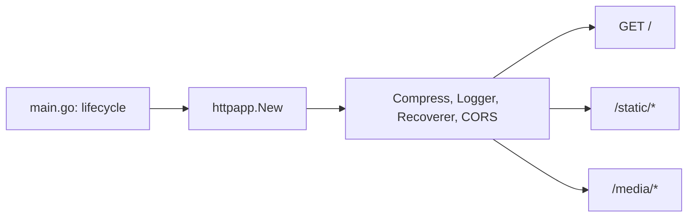

# HTTP composition

`internal/httpapp` owns the full request-serving handler. `main.go` owns process lifecycle and passes in filesystems that are already rooted.

## Boundary

- `main.go` (lifecycle): `-l` selects `:3000` (otherwise `:80`), opens `logs/site.log`, calls `cfg.Load()`, roots `fs.Sub(static, "static")` and `os.DirFS("media")`, then calls `ListenAndServe`.
- `httpapp.New(staticFS, mediaFS, corsOrigins)` (`internal/httpapp/app.go`) takes rooted filesystems and returns `http.Handler`.

```go
// main.go
handler := httpapp.New(staticFS, mediaFS, cfg.CORSAllowedOrigins)
```

## Middleware and routes

`newApp` in `internal/httpapp/app.go` sets the order:

1. `middleware.Compress(5, ...)` for text/html, text/css, application/javascript, application/json, and text/javascript. Standard Chi gzip only; Brotli is not configured.
2. `middleware.Logger`
3. `middleware.Recoverer`
4. CORS, only when at least one origin is configured. See [cors.md](cors.md).

Routes:

- `GET /` calls `handlers.Home`.
- `/static/*` serves `staticFS` with `http.FileServer`. `.js` files are served as `application/javascript`.
- `/media/*` serves `mediaFS` with `http.FileServer`.



## Invariants

- `newApp` calls `config.ValidateCORSOrigins` and panics on error. A wildcard or malformed origin never becomes a permissive policy.
- The caller roots the filesystems. `httpapp` does not know the embed or host layout.
- Handlers are stateless. `handlers/home.go` renders from request context only.

## Rationale

- Serving policy is one module's contract. Tests reach the real composed handler: `TestHomeOK`, `TestStaticAndMedia`, `TestCORS`, `TestRecoverer`, `TestCompressionGzip` in `internal/httpapp/app_test.go`.
- Rejected: assembling router and middleware in `main`. That is only testable with a process harness, and policy drifts with bootstrap.
- Rejected: choosing filesystem roots inside `httpapp`. That couples composition to the embed and host layout.
- `newApp` returns `*chi.Mux` so tests can register probe routes. `New` returns `http.Handler`.

Related: [cors.md](cors.md), [../config/cors-origins.md](../config/cors-origins.md).
