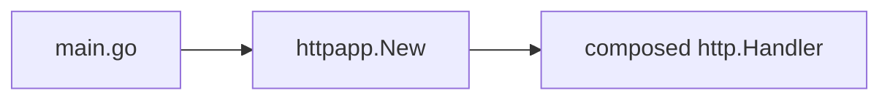

# HTTP surface

The request-serving surface is `internal/httpapp`. It exposes one constructor, `New`, that returns the composed `http.Handler`. Routes, middleware order, and CORS policy are owned there. Process lifecycle stays in `main.go`.

- [composition.md](composition.md) - the seam, middleware order, routes, and invariants
- [cors.md](cors.md) - which routes CORS covers and how it is mounted

Origin parsing and validation are owned by [../config/cors-origins.md](../config/cors-origins.md).

