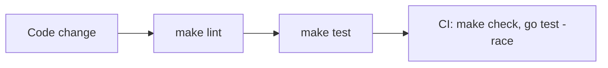

# Practices

Patterns that recur in the code at HEAD.

- **Process versus request boundary.** `main.go` handles flags, logging, config, filesystem rooting, and the listener. `internal/httpapp` handles routing and middleware. See [http/composition.md](http/composition.md).
- **Fail closed.** Invalid CORS config stops startup (`config.Load` error, then `log.Fatalf` in `main.go`) and panics at `httpapp.New`. See [config/cors-origins.md](config/cors-origins.md).
- **Test the composed handler.** `internal/httpapp/app_test.go` drives `httpapp.New` directly, not its internals.
- **Mark intentional limits.** Code marks deliberate limits with `// deliberate:` (see `config/config.go` and `internal/httpapp/app.go`).
- **Generated code is tracked.** `_templ.go` files are committed. `make gen` regenerates them from `.templ` sources.
- **Checks.** `make lint` runs golangci-lint v2.1.6, pinned in `Makefile`. `make test` runs `go test -race`. `make check` runs lint only. Both CI workflows (`.github/workflows/pr-workflow.yml` and `prod-workflow.yml`) run `make check` and `go test -race ./...` with default vet checks enabled.
- **Decision rationale lives in `.mem/`.** `AGENTS.md` (Project Memory) names it as the record.

