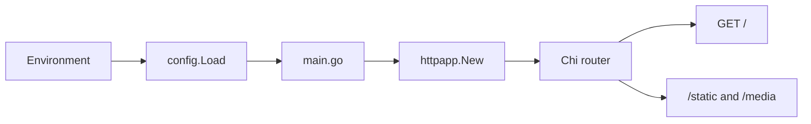

# Summary

go-pwa-forge is a Go template for hypermedia web apps. It uses a Chi router composed in `internal/httpapp/app.go`, Templ views under `views/`, Datastar on the client (`views/layout/base.templ`), and Tailwind CSS. `main.go` handles process lifecycle, loads configuration from the environment, roots the static and media filesystems, and starts the listener. The module path is `github.com/jrswab/go-htmx-forge`.

Related: [http/composition.md](http/composition.md), [config/summary.md](config/summary.md), [frontend/summary.md](frontend/summary.md).
